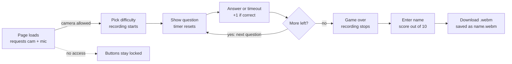

# Quiz Game with Webcam and Microphone support

**Live demo:** https://kgoel9899.github.io/Quiz_With_Webcam_Mic/

A browser-based, timed multiple-choice quiz that records the test-taker's webcam and microphone for the whole attempt and lets them download the recording at the end — a lightweight take on an online proctored exam.

It runs entirely in the browser (no server, no database) and is hosted as a static site on GitHub Pages. Made using HTML, CSS and JavaScript, with the MediaDevices and MediaStream Recording Web APIs.

## Features

- **Camera and mic gate** — the page asks for webcam and microphone permission on load; the difficulty buttons stay disabled until access is granted, so no one can take the quiz unrecorded.
- **Live self-view** — a muted live preview of the webcam shows while the quiz runs.
- **Three difficulty levels** — difficulty sets the time limit for each question:

  | Level  | Time per question |
  | ------ | ----------------- |
  | Easy   | 50 s              |
  | Medium | 25 s              |
  | Hard   | 10 s              |

- **Timed questions** — a countdown shows the seconds left; at zero the quiz moves to the next question automatically and the unanswered question scores zero.
- **10-question bank** — web-development questions (HTML, JavaScript, networking), each with 2–4 options.
- **Scoring and results** — after the last question, enter your name to see "Score: X out of 10".
- **Recording download** — the session recording is saved as `<name>.webm` straight from the browser.

## Tech stack

| Layer         | What it uses                                                               |
| ------------- | -------------------------------------------------------------------------- |
| Markup        | HTML5, one page (`index.html`)                                             |
| Styling       | CSS3 + Bootstrap 3.3.7, responsive viewport                                |
| Logic         | Vanilla JavaScript (ES6), DOM manipulation                                 |
| Media capture | MediaDevices API — `navigator.mediaDevices.getUserMedia({audio, video})`   |
| Recording     | MediaStream Recording API — `MediaRecorder`, `Blob` chunks                 |
| File download | `Blob` + `URL.createObjectURL` + a generated `<a download>` link           |
| Hosting       | GitHub Pages (static)                                                      |

## How it works

Recording runs from the moment a difficulty is picked until the last question is done.



The app is a single page; screens are switched by toggling a `hide` CSS class. `script.js` has eight small functions: `choose` (pick difficulty, start recording), `startGame`, `show` (render the next question), `curr` (check the clicked answer), `timing` (the countdown), `gameOver` (stop recording), `final` (show results) and `download`. Recorded chunks are collected in `ondataavailable` and joined into one `video/webm` `Blob` when the user clicks download.

## Running locally

1. Clone the repo and serve the folder over `localhost`, e.g. `python3 -m http.server 8000`, then open http://localhost:8000. Browsers only allow camera access on HTTPS or `localhost`, so opening `index.html` directly as a file may not work.
2. Allow camera and microphone access when the browser asks.
3. Pick Easy, Medium or Hard; the recording starts at that moment.
4. Answer the 10 questions, enter your name, then click **Download the recording**.

To change the questions, edit the `questions` array at the bottom of `script.js`. Each entry looks like:

```js
{
  q: "HTML stands for?",
  a: [
    { text: "Hyper Text Markup Language", correct: true },
    { text: "High Text Markup Language", correct: false }
  ]
}
```
